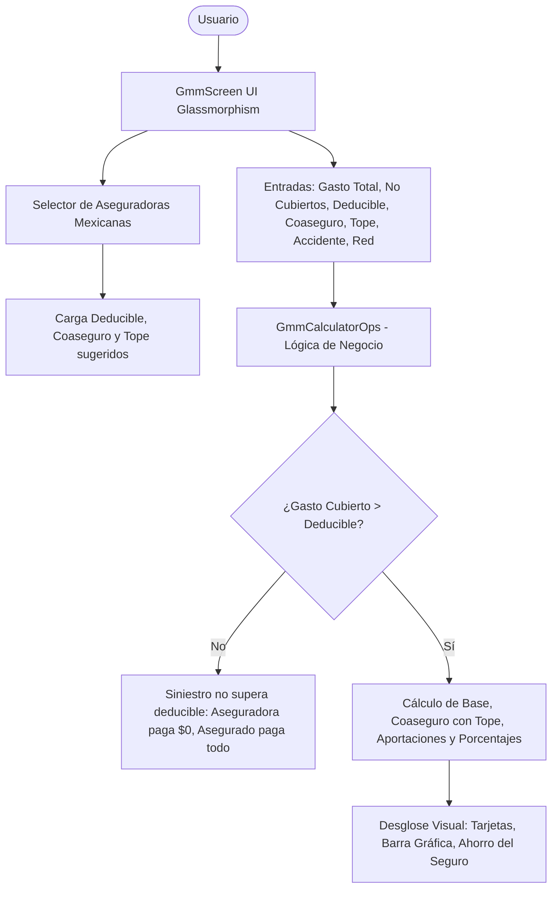

# Plan de Implementación: Calculadora de Gastos Médicos Mayores (GMM) - México

**Fecha y Hora:** 2026-10-14 23:32 (Hora Local)  
**Proyecto:** Calculadora Científica & Suite Avanzada  
**Normativa:** Cumplimiento con [AGENTS.md](file:///Users/franciscogomezbarragan/Herd/CALCULADORA-CIENTIFICA/AGENTS.md)

---

## 1. Visión General del Requerimiento

Integrar una **Calculadora de Gastos Médicos Mayores (GMM)** especializada en el funcionamiento del mercado asegurador mexicano. El módulo permitirá a los usuarios simular y proyectar con total precisión el desembolso real en caso de siniestro (enfermedad o accidente), calculando:
1. Gasto total del siniestro vs. Gastos no cubiertos / no procedentes.
2. Deducible contratado y beneficio de **Cero Deducible por Accidente**.
3. Coaseguro porcentual y **Tope de Coaseguro (Stop Loss)**.
4. Ajustes/penalizaciones por atenderse en red o fuera de convenio/nivel hospitalario.
5. Perfiles preconfigurados con las aseguradoras líderes de México:
   - **GNP Seguros** (Línea Azul Premier / Flexible)
   - **AXA Seguros** (Flex Plus / Círculo Médico)
   - **MetLife México** (MedicalLife / Práctico)
   - **Seguros Monterrey New York Life - SMNYL** (Alfa Medical / Flex)
   - **Mapfre México** (Protección Médica a tu Medida)
   - **Seguros Inbursa**
   - **Banorte / BBVA Seguros**
   - **Póliza Personalizada** (permite ingresar parámetros 100% a la medida)

---

## 2. Arquitectura de la Solución

### 2.1 Archivos a Crear y Modificar:
1. **`lib/models/gmm_insurance_models.dart`** (Nuevo):
   - Modelo de perfil de aseguradora (`GmmInsurerProfile`): nombre, icono, descripción, deducible por defecto, coaseguro estándar, tope típico, reglas de cero deducible por accidente y penalizaciones por red.
   - Modelo de parámetros de entrada (`GmmCalculationInput`).
   - Modelo de resultados del cálculo (`GmmCalculationResult`).

2. **`lib/utils/gmm_calculator_ops.dart`** (Nuevo):
   - Motor de cálculo aritmético puro con reglas de GMM México:
     - Descuento de gastos no cubiertos.
     - Evaluación de condición de accidente (exención de deducible).
     - Evaluación de procedencia (gasto cubierto vs deducible).
     - Aplicación de coaseguro sobre la base indemnizable.
     - Aplicación del tope de coaseguro (cálculo de ahorro por tope).
     - Total asegurado vs. aseguradora y desglose porcentual.

3. **`lib/screens/gmm_screen.dart`** (Nuevo):
   - Interfaz con diseño Glassmorphism compatible con Modo Claro y Oscuro.
   - Selector visual de aseguradoras con logos/chips y colores distintivos.
   - Controles interactivos con formato de moneda y porcentajes.
   - Switches táctiles para "Beneficio de Cero Deducible por Accidente" y "Atención Fuera de Red / Nivel Superior".
   - Tarjetas de resultados con desglose detallado, barra porcentual visual comparativa y resumen de ahorro.
   - Acordeón educativo "Glosario y Guía GMM en México" (Deducible, Coaseguro, Tope de Coaseguro, Red y Tabulador).

4. **`lib/screens/home_screen.dart`** (Modificación):
   - Agregar el nuevo módulo a la barra de navegación móvil (`TabBar` con 8 pestañas) y al selector de herramientas de escritorio (`_buildDesktopToolSelector` con 6 herramientas).
   - Conectar la navegación fluida.

5. **`test/gmm_calculator_test.dart`** (Nuevo):
   - Pruebas unitarias que validen:
     - Caso donde el gasto es menor al deducible (no procede).
     - Caso estándar con deducible y coaseguro sin topar.
     - Caso con tope de coaseguro alcanzado.
     - Caso de accidente con cero deducible.
     - Caso de penalización por atención fuera de red.
     - Perfiles de aseguradoras precargados.

6. **`docs/MANUAL.md`** (Modificación):
   - Incorporar la sección dedicada al módulo de Gastos Médicos Mayores con explicación clara de cómo funciona en México.

---

## 3. Plan de Verificación y Pruebas

1. **Pruebas Unitarias Automatizadas**:
   - Ejecutar `flutter test test/gmm_calculator_test.dart` para garantizar que todos los escenarios matemáticos y de cobertura sean exactos al centavo.
2. **Análisis Estático**:
   - Ejecutar `flutter analyze` para asegurar 0 advertencias y 0 errores de linting.
3. **Prueba en Aplicación**:
   - Validar responsive layout (móvil y escritorio) y correcta reactividad al cambiar aseguradoras y activar/desactivar switches.

---

## 4. Registro y Entrega

Al culminar la implementación y verificación:
- Se generará el reporte de entrega en `docs/2026-10-14_23-32_walkthrough.md`.
