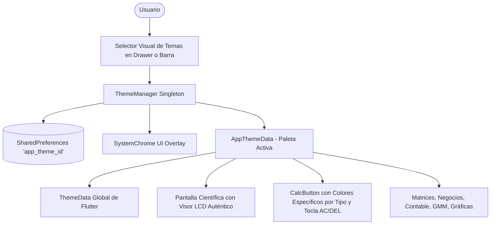

# Plan de Implementación: Sistema de Temas Casio & Clásicos

**Fecha y Hora:** 2026-10-15 00:06 (Hora Local)  
**Proyecto:** Calculadora Científica & Suite Avanzada  
**Normativa:** Cumplimiento con [AGENTS.md](file:///Users/franciscogomezbarragan/Herd/CALCULADORA-CIENTIFICA/AGENTS.md)

---

## 1. Visión General del Requerimiento

El usuario proporcionó 5 fotografías de calculadoras científicas reales icónicas (modelos Casio y derivados de alta popularidad) para crear un sistema integral de cambio de temas visuales que complemente los temas clásicos (Claro y Oscuro):

1. **Casio fx-991ES PLUS (2nd Edition)**:
   - Cuerpo negro carbón mate (`#18181B`).
   - Pantalla LCD *Natural V.P.A.M.* verde olivo retro (`#C5D6AF`) con dígitos LCD de alto contraste (`#142210`).
   - Botones numéricos gris perla / plata, botones científicos negro mate con serigrafía dorada/blanca, tecla `DEL` en verde lima (`#84CC16`) y `AC` en naranja-rojo (`#EF4444`).
2. **Casio Gris Grafito / Slate (M&G Scientific)**:
   - Cuerpo gris grafito oscuro (`#22272E`), visor LCD clásico verdoso (`#B8C9A6`), teclas numéricas gris azulado y acentos rosa/magenta en teclas de borrado.
3. **Casio Blanco Perla (DEXIN KK-82MS-B)**:
   - Carcasa blanca tiza limpia (`#F8FAFC`), pantalla LCD contrastada, botones de funciones grises y acentos rojos/salmón.
4. **Casio Rosa Pastel (DEXIN KK-82MS-B)**:
   - Carcasa rosa pastel suave (`#FCE7F3`), pantalla LCD retro cálida, botones con acentos frambuesa y rosa vintage.
5. **Casio Azul Cielo / Pastel (KK-82MS-D)**:
   - Carcasa azul celeste pastel (`#BAE6FD`), botones blancos con rotulación azul, pantalla LCD monocromática y detalles en rojo vibrante.
6. **Casio Azul Translúcido Y2K (Celica CA-83)**:
   - Estética noventera translúcida azul cobalto / zafiro con profundidad glassmorphic, pantalla gris plata y teclas bicolores con acentos rubí.
7. **Temas Clásicos Existentes**:
   - Clásico Oscuro (Índigo Profundo Glassmorphism)
   - Clásico Claro (Lavanda Suave Glassmorphism)

---

## 2. Arquitectura de la Solución

### 2.1 Archivos a Crear y Modificar:
1. **`lib/models/app_theme_models.dart`** (Nuevo):
   - Definición del enum `AppThemeId`.
   - Clase `AppThemeData` con especificación completa de tokens de diseño:
     - Colores de chasis / fondos / gradientes / esferas difusas.
     - Colores de pantalla LCD (fondo, dígitos principales, expresiones secundarias, borde).
     - Tipografía para visor LCD (ej. `GoogleFonts.vt323`, `GoogleFonts.shareTechMono` o `GoogleFonts.outfit`).
     - Colores de teclas por tipo: números, científicos, operadores, igual, tecla `AC` y tecla `DEL`.
     - Colores de tarjetas y paneles.
   - Catálogo estático `AppThemes.allThemes` con los 8 temas perfectamente calibrados.

2. **`lib/utils/theme_manager.dart`** (Modificación):
   - Extender para soportar `AppThemeId`.
   - Métodos `setAppTheme(AppThemeId id)` y persistencia en `SharedPreferences`.
   - Propiedad `AppThemeData get currentTheme`.
   - Adaptación dinámica de `Brightness` y `SystemChrome`.

3. **`lib/main.dart`** (Modificación):
   - Suministrar el `ThemeData` correspondiente generado desde `themeManager.currentTheme.toThemeData()`.

4. **`lib/widgets/calc_button.dart`** (Modificación):
   - Consultar el `AppThemeData` activo desde `ThemeManager`.
   - Respetar los colores especializados de teclas para cada modelo de calculadora (números claros, científicos oscuros, acento verde `DEL`, rojo `AC`, etc.).

5. **`lib/screens/scientific_screen.dart`** (Modificación):
   - Aplicar el estilo del visor LCD auténtico de la calculadora seleccionada (borde LCD, fondo verde/grisáceo característico, dígitos LCD con fuente retro o moderna según el tema).

6. **`lib/screens/home_screen.dart`** (Modificación):
   - Adaptar los fondos, esferas difusas y contrastes al tema activo.
   - En el Drawer, crear un selector de temas visual e interactivo tipo tarjeta/grilla con muestras de color representativas de cada modelo Casio.

7. **`test/theme_manager_test.dart`** (Nuevo):
   - Pruebas unitarias para validar persistencia, conmutación de temas y consistencia de paletas de color.

---

## 3. Plan de Verificación y Pruebas

1. **Pruebas Unitarias**:
   - `flutter test` ejecutando las pruebas de temas, GMM y suite completa.
2. **Análisis Estático**:
   - `flutter analyze` verificando 0 advertencias.
3. **Validación Visual**:
   - Comprobar que cada tema refleje con fidelidad el aspecto de las calculadoras reales de las fotos.

---

## 4. Registro y Entrega

Al culminar la implementación y verificación:
- Se generará el reporte de entrega en `docs/2026-10-15_00-06_walkthrough.md`.
